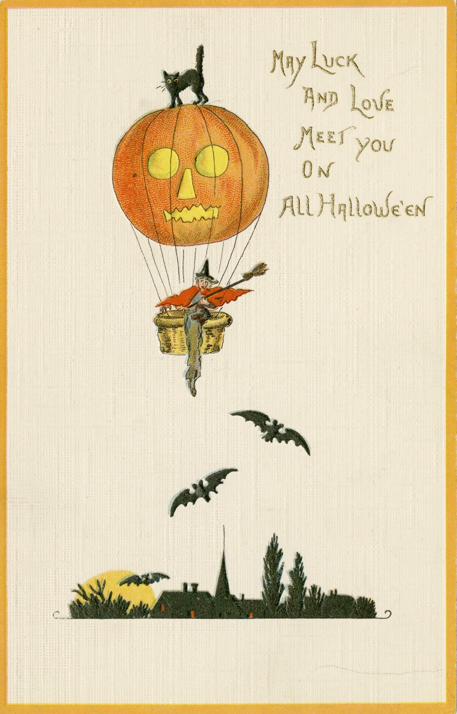
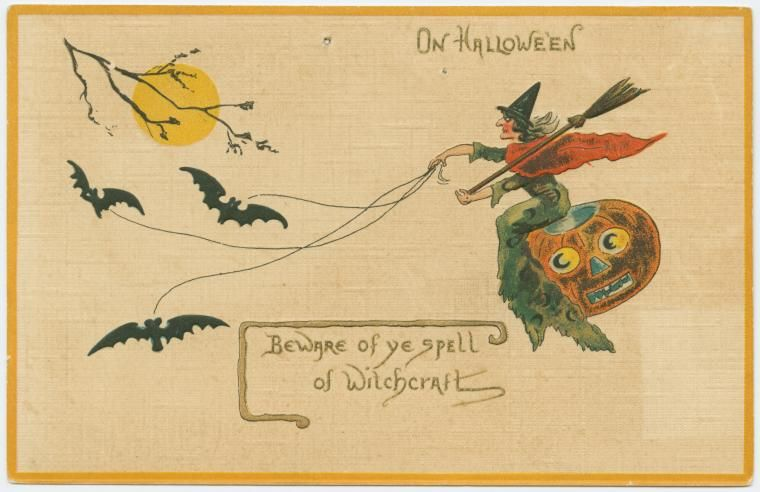

# Postcard art

The Hallowe'en locks are cut from two old postcards. The full cards are here
so you can see where each piece came from. They're for the repo only and
don't ship with the addon, which only packs the files the .toc lists and
Media/.

Both cards are in the public domain. Neither one names an artist.

## May Luck and Love Meet you on All Hallowe'en

A lithograph postcard from about 1912. A witch and a black cat fly a
jack-o'-lantern balloon over a town, with bats all round.

- From the Toronto Public Library, marked Public Domain:
  https://digitalarchive.tpl.ca/objects/215201/may-luck-and-love-meet-you-on-all-halloween
- Found through the Public Domain Image Archive (public domain in the U.S., no
  further rights on the scan):
  https://pdimagearchive.org/images/0ad537d7-0d8b-4e97-aa4d-bef51b792d52/
- The library's terms let you reuse it for any purpose. A credit line,
  "Courtesy of Toronto Public Library", is welcome but not asked for:
  https://tpl.ca/digital-archive/licences/

The balloon of the Pumpkin Balloon lock and the witch in her basket come
from this card. So do the two
bats and the town that the Pumpkin Balloon and the Pumpkin Patch share, and
the paper every postcard lock sits on. The pumpkin of the pumpkin hunt is
the balloon without its ropes.

## On Hallowe'en

A postcard from about 1910, with a witch, a moon and bats.

- From the New York Public Library:
  https://digitalcollections.nypl.org/items/510d47e3-4771-a3d9-e040-e00a18064a99
- Found through the Public Domain Image Archive (public domain in the U.S., no
  further rights on the scan):
  https://pdimagearchive.org/images/235bc0b1-7c2e-4aa3-b693-14a319708339/

The Witch's Kite lock's witch and the three bats on her strings come from
this card. So does the moon over the Witch's Kite, the Talking Board and the
Pumpkin Patch.

## The rest

The talking board's planchette, the rings and discs on the slots and tags,
and the soil and holes of the Pumpkin Patch are drawn, not cut from a card.
